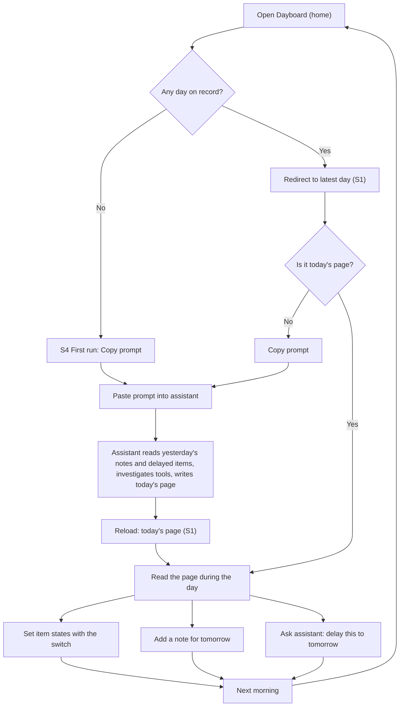

# User Flow — Dayboard, first version

The daily loop that the scope document (`ideation/scope-definition/scope-document.md`) describes as its value stream, drawn as screens and steps. Screen names (S1–S6) refer to `wireframes.md`. The backlog items each flow exercises come from `ideation/scope-definition/intent-backlog.md`. The success check they serve, daily use with no fallback, comes from `ideation/intent-capture/intent-statement.md`.

## Core Flow: a working day

<!-- Text fallback: You open Dayboard. If there are no days, the first-run screen offers the copy prompt. Otherwise the home page redirects to the latest day. If that isn't today, you copy the prompt and paste it into your assistant, which reads yesterday's notes and delayed items, investigates your tools and writes today's page. You read the page during the day, set states, add notes for tomorrow, or ask the assistant to delay items. The next morning the loop starts again. -->

| Step | Screen | You | Dayboard | Backlog |
|---|---|---|---|---|
| 1 | Home | Open Dayboard | Redirects to the latest day on record, or shows S4 when there is none | IB-04 |
| 2 | S1 or S4 | Press Copy prompt | Puts the update instruction on the clipboard, and the button reads "Copied" | IB-08 |
| 3 | Your assistant | Paste the prompt | The assistant reads notes and delayed items from the latest day, then writes today's blocks in its own order | IB-03, IB-06 |
| 4 | S1 | Reload or reopen | Shows today with the assistant's blocks | IB-01, IB-04 |
| 5 | S1 | Set states during the day | Saves each change; reverts with a message if saving fails | IB-05 |
| 6 | S1 | Add a note for tomorrow | Adds it to the notes block | IB-06 |

## Secondary Flow: looking back

| Step | Screen | You | Dayboard | Backlog |
|---|---|---|---|---|
| 1 | S1 | Press the previous arrow | Opens the previous day that has a page | IB-07 |
| 2 | S1 | Press the date | Opens the calendar (S2), with days that have no page greyed out | IB-07 |
| 3 | S2 | Pick a day | Opens that day at its own address | IB-07 |
| 4 | S2 | Press "Go to latest day" | Opens the latest day on record | IB-07 |

## Secondary Flow: the assistant fills in a past day

| Step | Who | Action | Result | Backlog |
|---|---|---|---|---|
| 1 | You | Ask your assistant to record a day you missed | — | IB-03 |
| 2 | Assistant | Creates a page for that date, the same way it creates today's | The day appears in the calendar and is no longer greyed out | IB-03, IB-07 |

## Error Paths

| Condition | What you see | Recovery |
|---|---|---|
| Backend not running | "Can't reach Dayboard on this computer. Is the backend running?" (S6) | Start the backend, then press Try again |
| A state change fails to save | The switch reverts, with "Couldn't save, try again" (S6) | Press the switch again |
| Address for a date with no page | "No page for this day" (S5) | Go to latest day, or use the calendar |
| Copy to clipboard refused by the browser | "Couldn't copy. Select the prompt below." with the prompt shown as text | Copy it by hand |

## Assumptions & Open Questions

- **After the assistant writes, you reload.** Live updates while the page is open are not in scope.
- **The clipboard fallback** (showing the prompt as text) is a proposal.
