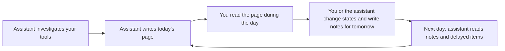

# Scope Document — Dayboard, first version

Inputs: the approved intent statement (`ideation/intent-capture/intent-statement.md`), the feasibility assessment (`ideation/feasibility/feasibility-assessment.md`), the constraint register (`ideation/feasibility/constraint-register.md`), and the answers in `scope-definition-questions.md` (Q1–Q5).

## Minimum Viable Scope

The first version is the smallest Dayboard that lets one person use it every working day for two weeks without falling back to the chat-artifact report (intent statement, Success Metrics). For that test, everything in the description is needed from day one, and nothing is deferred (Q4).

## In Scope

| Area | What the first version does | Source |
|---|---|---|
| Day pages | One page per day, with a title and blocks of six fixed kinds: schedule, open items, pull requests, learnings, waiting on others, notes for tomorrow. A block holds items; an item has text, optional links and a state (open, done, delayed to tomorrow). | intent statement |
| Opening the page | The page always opens on the latest day on record, today or later. | intent statement |
| Earlier days | A calendar opens any earlier day, and days with no page are greyed out. | Q3 |
| What you do on the page | You change item states and write notes for tomorrow. | Q1 |
| What the assistant does | It lists days, reads a page, writes and updates blocks and items, changes states, writes notes for tomorrow, and reads and edits any earlier day. It can also create a page for any date, including a past one, the same way it creates today's page. | intent statement, Q1, Q3, your clarification at this stage's review |
| Delayed items | Nothing moves automatically. The assistant sees delayed items when it prepares the next day and carries them over itself. | Q2 |
| Notes for tomorrow | The assistant writes them when you ask, and you can write them on the page. The page shows them. The assistant reads them by a list of dates, or from the latest day on record when no dates are given. | intent statement, Q1 |
| "Copy prompt" button | Puts on the clipboard the instruction you paste into your assistant to update today's page. | intent statement, Q4 |
| Look and feel | Current-looking interface with a type scale, spacing, hierarchy and considered states, in light and dark, and usable at phone width. | intent statement, Q4 |
| Running it | One command starts the backend and one starts the web app, on this computer. Each person runs their own copy. | constraint register TC-02, TC-06 |
| Privacy | Page content is never committed, and nothing but this machine can read it. The server answers only this machine, its own page and your assistant. | constraint register SC-01, SC-02; feasibility R1, R2 |

## Out of Scope (not designed out)

| Excluded from this version | Source |
|---|---|
| Users, sign-in and authentication | intent statement |
| Cloud deployment of any kind | intent statement |
| Custom block kinds added by users | intent statement |
| A plugin or engine layer | intent statement |
| Notifications | intent statement |
| Any integration that reads your tools directly (the assistant does that) | intent statement |
| A built-in import of today's chat-artifact reports. Dayboard starts fresh; if you want old reports in, the assistant creates those past days itself, the same way it creates today's page. | feasibility Q6, your clarification at this stage's review |
| Opening the page from another device, such as your phone; phone width is a layout requirement only | feasibility Q3 |

## Value Stream

<!-- Text fallback: The assistant investigates your tools and writes today's page. You read it during the day. You or the assistant change item states and write notes for tomorrow. The next day the assistant reads those notes and the delayed items, and writes the new page, which closes the loop. -->

## Sequencing

You have no preference on build order (Q5). The backlog (`intent-backlog.md`) proposes a dependency-first order that puts the privacy guard into the first slice, because the content is sensitive from the first real day (constraint register SC-01). The final order is set in Delivery Planning.

## Assumptions & Open Questions

- **Storage choice is still open** (constraint register TC-05). It is decided before the day-page shape is built.
- **"Today" follows this computer's clock and time zone** (feasibility RAID log A1).
