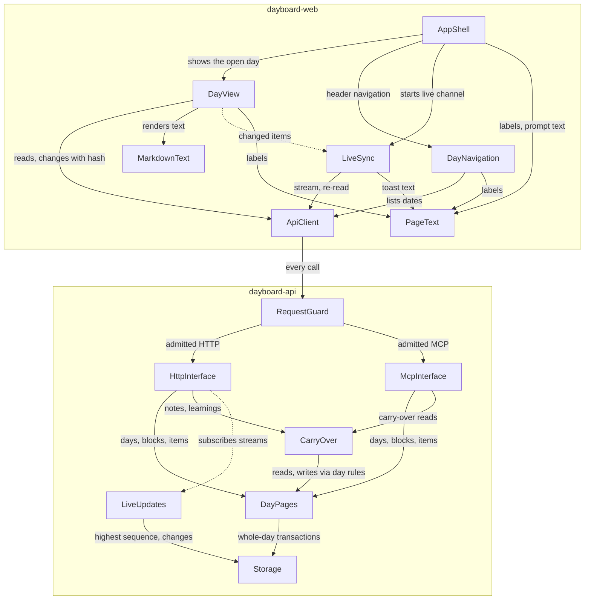

# Components — Dayboard, first version

The logical building blocks of Dayboard: the code that gets written, not the things it runs on. The catalogue below is the source of truth; the diagram and tables after it are derived from it. Deployment grouping (which blocks become which pieces of work) is decided in Units Generation; wire formats, the MCP transport and the server-sent events contract in Contract Design; data types and validation detail in Functional Design. Decisions are recorded in `decisions.md` (ADR-001 to ADR-009). Entities are named at ownership and shape level only.

Seven blocks live in the backend (`dayboard-api`) and seven in the web app (`dayboard-web`).

```yaml
components:
  # ---------- backend (dayboard-api) ----------
  - name: RequestGuard
    summary: Admits a connection only when it comes from this computer, names this computer as its host, and (for browser requests) carries the web app's own origin.
    behaviour: >
      Runs before any interface sees a request, for HTTP calls, the server-sent events stream and the MCP server alike.
      Refuses a connection whose peer address is not a loopback address (FR8.3); refuses a request whose Host is not
      localhost, 127.0.0.1 or ::1, with or without a port (FR8.5); refuses a browser request whose Origin is present and
      is not the web app's own address (FR8.4). A refusal reads and changes nothing and returns a plain refusal with no
      page content. The allowed web origin comes from configuration with a safe default; no rule is relaxed by a flag.
      Holds no data. Every rule has its own automated test (NFR1). The rules apply for as long as Dayboard has no sign-in.
      Every process that listens on a network port runs its own RequestGuard in front of its listener, including an MCP
      process the assistant starts over HTTP, with the same tests. An MCP process that speaks stdio listens on no port:
      it talks only to the program on this computer that started it, so no web page or other machine can reach it, and it
      needs no guard (ADR-006).
    responsibilities:
      - Loopback-only peer check
      - Host-name check
      - Origin check for browser requests
      - Handing admitted requests to the right interface
    depends_on:
      - component: HttpInterface
        interaction: hands on admitted HTTP requests and server-sent events subscriptions
        style: sync
      - component: McpInterface
        interaction: hands on admitted MCP requests
        style: sync
    dependents:
      - component: ApiClient
        interaction: every call the web app makes reaches the backend through the guard first
    external_dependencies: []
    entities: []

  - name: HttpInterface
    summary: The backend's HTTP adapter for the web app, including the server-sent events stream of day-changed notices.
    behaviour: >
      Translates HTTP requests into calls on DayPages and CarryOver and their results into responses; holds no day rules.
      Every read of one day returns the page hash; every change request must carry the hash of its last read and is
      passed on with it (FR4.9). Error results keep the field, problem and limit named by the domain (FR2.10). Opens one
      server-sent events stream per open page and forwards the notices LiveUpdates hands it; the stream carries only
      dates, hashes and removals, never page content (Q6). Never touches storage directly (NFR10).
    responsibilities:
      - Day list, day read and day change endpoints for the web app, including saving and discarding notes and learnings
      - Note and learning add endpoints
      - Item and block removal endpoints
      - The day-changed server-sent events stream
    depends_on:
      - component: DayPages
        interaction: reads and changes pages, blocks and items
        style: sync
      - component: CarryOver
        interaction: adds notes and learnings
        style: sync
      - component: LiveUpdates
        interaction: subscribes each open page's stream to day-changed notices
        style: event
    dependents:
      - component: RequestGuard
        interaction: receives admitted HTTP requests and stream subscriptions
    external_dependencies: []
    entities: []

  - name: McpInterface
    summary: The MCP server the assistant uses; a thin adapter over the same rules the page uses.
    behaviour: >
      Exposes the assistant's operations (FR2.1 to FR2.12) as MCP tools and translates them into calls on DayPages and
      CarryOver; holds no day rules, so the assistant and the person have the same rights (FR2.6). Every day read returns
      the page hash and every change carries one (FR4.9). Its tool descriptions tell the assistant how to write item text,
      including headings at level 3 or smaller (FR2.12). Refused writes return the domain's error unchanged (FR2.10). Can
      run in more than one process at once (ADR-007): inside the backend behind its RequestGuard, as a separate process
      over HTTP with its own RequestGuard on a loopback listener, or as a stdio process started by the assistant, which
      listens on no port (ADR-006). It never notifies pages itself, because LiveUpdates finds every write in storage.
    responsibilities:
      - MCP tools for listing, reading, creating, changing and removing days, blocks and items
      - MCP tools for notes for tomorrow and learnings
      - Tool descriptions that teach the assistant the text rules
    depends_on:
      - component: DayPages
        interaction: reads, creates, changes and removes days, blocks and items
        style: sync
      - component: CarryOver
        interaction: reads notes for tomorrow and saved learnings across days
        style: sync
    dependents:
      - component: RequestGuard
        interaction: receives admitted MCP requests
    external_dependencies:
      - name: MCP protocol library
        kind: other
        purpose: speaks the Model Context Protocol to the assistant (chosen in Contract Design)
    entities: []

  - name: DayPages
    summary: Owns every day page, its blocks and items, the page hash, and the rules that keep a day valid.
    behaviour: >
      The only place day content is created, changed or removed. A day page is one unit of change (ADR-003): it is
      loaded, checked and saved whole inside one storage transaction, and the page hash covers all of it. A change whose
      hash is not the page's current one is refused and stores nothing (FR4.9); because the hash check runs inside the
      write transaction, two writers in different processes cannot both succeed from the same read. Enforces at most one
      page per date and no page after today by this computer's local clock (FR1.1, FR1.9, FR1.10); the six fixed block
      kinds, with at most one learnings and one notes-for-tomorrow block (FR1.4); identifiers given once and never reused
      (FR1.12); task states open, done and delayed for open items, pull requests and waiting on others (FR1.6); schedule
      items as all-day or timed with a meeting answer, including the overnight and malformed-time rules (FR1.13); every
      limit in NFR3; and nothing moving to another day by itself (FR1.11). Checks the note and learning states on every
      save, whichever caller made the change (ADR-004): a new learning is unsaved; unsaved can become saved or discarded;
      saved can only become discarded; nothing leaves discarded (FR1.7); notes are kept or discarded (FR1.8). A refused
      transition names the item and the change and stores nothing. Discarded notes and learnings are never returned by a
      read (FR2.3, FR3.10). Returns days exactly as stored, in the writer's order (FR1.3); display order and the Past mark
      are worked out by the web app (ADR-005).
    responsibilities:
      - Day pages, blocks and items, including note and learning items
      - The page hash and the refusal of stale changes
      - Every rule about dates, block kinds, item states, note and learning states, schedule times, identifiers and limits
      - Removal of items, blocks and whole days
    depends_on:
      - component: Storage
        interaction: loads and saves whole days inside one transaction, and lists dates
        style: sync
    dependents:
      - component: HttpInterface
        interaction: the web app's reads and changes
      - component: McpInterface
        interaction: the assistant's reads and changes
      - component: CarryOver
        interaction: reads days for the cross-day reads and adds notes and learnings through the day rules
    external_dependencies: []
    entities:
      - name: DayPage
        identifier: date
        attributes: [date, title, blockOrder, hash, createdAt, updatedAt]
      - name: Block
        identifier: blockId
        attributes: [blockId, kind, title, itemOrder]
        references:
          - entity: DayPage
            owned_by: DayPages
            relationship: each block belongs to exactly one day page
      - name: Item
        identifier: itemId
        attributes: [itemId, text, links, taskState, allDay, startTime, endTime, meetingAnswer, learningState, noteState]
        references:
          - entity: Block
            owned_by: DayPages
            relationship: each item belongs to exactly one block
      - name: Link
        identifier: position within its item
        attributes: [address, label]
        references:
          - entity: Item
            owned_by: DayPages
            relationship: each link belongs to one item, up to 10 per item

  - name: CarryOver
    summary: The cross-day reads for notes for tomorrow and learnings, and adding notes and learnings.
    behaviour: >
      Answers the cross-day reads: kept notes for named dates (FR2.8); kept notes of the latest day before today plus
      today's, stating the dates (FR2.9); saved learnings across a date range (FR2.11). Adds the person's notes and
      learnings, refusing empty text and creating the block on first use (FR4.5 to FR4.7). The note and learning state
      rules are checked by DayPages on every save, so no caller can skip them (ADR-004). Holds no data of its own: it
      reads and writes only through DayPages, so the page hash and the one save path stay in one place.
    responsibilities:
      - Notes for tomorrow across dates
      - Saved learnings across a date range
      - Adding notes and learnings, including creating their block
    depends_on:
      - component: DayPages
        interaction: reads days and dates; adds notes and learnings with the page hash
        style: sync
    dependents:
      - component: HttpInterface
        interaction: the person adding notes and learnings
      - component: McpInterface
        interaction: the assistant's carry-over reads
    external_dependencies: []
    entities: []

  - name: Storage
    summary: The one module that reads and writes the day data, behind an interface that another store could replace.
    behaviour: >
      Keeps all day data in one SQLite database file inside the git-ignored data folder (ADR-001, FR8.6), created on
      first run (FR8.2). Offers whole-day load and save inside one write transaction that locks the database for that
      write, so a write is whole or not at all and survives a restart once confirmed (NFR5). In the same transaction as
      every save or removal it records a day change: the date, its new hash or that it was removed, and a growing
      sequence number (ADR-007). Exposes the highest change sequence, the changes after a given sequence, and the oldest
      sequence still kept. Runs the database with write-ahead logging, so readers never block the writer, and full
      durability on commit (NFR5). A writer that finds the write lock held waits a short, bounded time and then refuses
      with a retryable error instead of hanging (ADR-001); the wait fits inside the 300 ms bound of NFR2. Keeps a schema
      version; on start-up, when an upgrade is due, it keeps a copy of the data as it was and then moves existing days
      forward (NFR6). It first takes the write lock; while holding it, it makes the copy with SQLite's own backup
      interface (part of the standard library's `sqlite3`, consistent under write-ahead logging, unlike a plain file
      copy), then runs the upgrade in that same locked write transaction. Every process reads the schema version again
      once it holds the lock, so when several processes start together only the first makes the copy and upgrades, and
      the others find the schema already current and skip both. If the upgrade fails, the transaction rolls back, the
      data stays as it was, the copy is kept, and the process stops with a clear message instead of serving. A process that finds a newer schema version than it knows refuses
      to start, with a clear message, so an older process never writes data in an old shape. Stores text
      byte for byte (NFR4). No other component touches the file (NFR10); its interface names days, not tables, so a
      hosted store can replace it.
    responsibilities:
      - Loading, saving, listing and removing days
      - Write transactions, their lock and the bounded lock wait
      - The day-change log, its highest sequence and its trimming
      - Schema version, backup copy and upgrades
    depends_on: []
    dependents:
      - component: DayPages
        interaction: whole-day load, save, list and removal
      - component: LiveUpdates
        interaction: the highest change sequence and the day changes after a sequence
    external_dependencies:
      - name: SQLite (Python standard library sqlite3)
        kind: database
        purpose: the one data file holding every day and the day-change log
    entities:
      - name: DayChange
        identifier: sequence
        attributes: [sequence, date, hash, removed, changedAt]
        references:
          - entity: DayPage
            owned_by: DayPages
            relationship: each change names the day page it was written for, by date
      - name: SchemaVersion
        identifier: version
        attributes: [version, migratedAt]

  - name: LiveUpdates
    summary: Finds every day change in storage, whichever process wrote it, and hands notices to the open pages' streams.
    behaviour: >
      Reads the highest change sequence in storage about every 500 ms, so it sees writes from any process and any
      connection (ADR-007). When the sequence has grown it reads the day changes after the last sequence it handed on
      and turns each into a notice: the date, its new hash and its sequence, or that the date was removed (Q6, ADR-008).
      Hands each notice to every open stream it has been given by HttpInterface. A new stream starts at the latest
      sequence. A stream that was cut off and comes back gets the changes after its last seen sequence (FR3.15); when
      that sequence is older than the oldest change still kept, the stream instead tells the page to refresh the list
      of days and the open day. Carries no page content. Keeps the 2-second bound of FR3.11 with room to spare.
    responsibilities:
      - Watching storage for changes from any writer
      - Turning day changes into notices
      - Fanning notices out to open streams, with catch-up or a refresh after a reconnect
    depends_on:
      - component: Storage
        interaction: reads the highest change sequence and the day changes after a sequence
        style: sync
    dependents:
      - component: HttpInterface
        interaction: subscribes open pages' streams
    external_dependencies: []
    entities:
      - name: StreamSubscription
        identifier: subscriptionId
        attributes: [subscriptionId, lastSequence, openedAt]

  # ---------- web app (dayboard-web) ----------
  - name: AppShell
    summary: The frame of every screen - header, theme switch, Copy prompt, first-run view and error views.
    behaviour: >
      Renders the header with the name, Copy prompt and the Light, Dark, Auto switch; Auto is the default and the
      choice is remembered in this browser (FR7.1). Copy prompt puts the prompt text on the clipboard, shows "Copied"
      for 2 seconds, and shows the prompt as selectable text when the browser refuses (FR6.1 to FR6.4); at phone width
      it becomes an icon button (FR7.3). Shows the first-run view when no day exists (FR3.2), and the offline and
      day-failed messages (FR7.5). Holds the routes: the home address goes to the latest day (FR3.1) and every day has
      its own address (FR3.3). Contains no copy; every label comes from PageText.
    responsibilities:
      - Header, theme switch and Copy prompt
      - Routes for home and each day
      - First-run, offline and day-failed views
    depends_on:
      - component: DayView
        interaction: shows the open day
        style: sync
      - component: DayNavigation
        interaction: shows the arrows, date and calendar in the header
        style: sync
      - component: LiveSync
        interaction: starts the live channel and hosts its toast
        style: sync
      - component: PageText
        interaction: every label and the copy-prompt text
        style: sync
    dependents: []
    external_dependencies:
      - name: Browser clipboard and local storage
        kind: other
        purpose: copying the prompt; remembering the theme choice
    entities:
      - name: ThemeChoice
        identifier: the browser's storage key for the theme
        attributes: [value]

  - name: DayView
    summary: Shows one day and lets the person act on it.
    behaviour: >
      Shows the date as the main heading, the title and every block in stored order, each with its kind label and title,
      and "Nothing here" for an empty block (FR3.4). Works out the display-only rules from the stored day and this
      browser's clock (ADR-005): schedule items all-day first, then by start time, ties in stored order; a meeting
      marked Past within 5 seconds of its end, also on earlier days and after a clock change (FR4.10); done items folded
      into "N done" (FR3.5). Offers the state switch and meeting answer (FR4.1), saving at once and returning to the
      stored value on failure or on a stale hash (FR4.2, FR4.9); Save and Discard for learnings and Discard for notes with
      their confirmations (FR4.3, FR4.4); add fields (FR4.5 to FR4.7); and removal of items and blocks after a
      confirmation (FR4.8). Highlights the items LiveSync reports as changed, and never clears typed text or moves focus
      on an update, except that a removal wins (FR3.13). Shows "This block can't be shown" for a block it can't render
      (FR7.6). Contains no copy.
    responsibilities:
      - Rendering a day in stored order
      - Display rules - schedule order, Past mark, done fold
      - State switches, meeting answers, notes, learnings, adds, removals and confirmations
      - Keeping typed text and focus through live updates
    depends_on:
      - component: ApiClient
        interaction: reads the day and sends every change with the page hash
        style: sync
      - component: MarkdownText
        interaction: renders item, note and learning text
        style: sync
      - component: LiveSync
        interaction: learns which items changed, to highlight them
        style: event
      - component: PageText
        interaction: every label, message and confirmation text
        style: sync
    dependents:
      - component: AppShell
        interaction: shows the open day
    external_dependencies: []
    entities: []

  - name: DayNavigation
    summary: The previous and next arrows, the date button and the month calendar.
    behaviour: >
      Moves to the nearest earlier or later day with a page, disabling and naming an arrow at either end (FR5.1). Opens
      a month calendar from the date, where days without a page are muted and can't be chosen and "Go to latest day"
      opens the latest day (FR5.2); works by keyboard (FR5.3) and as a full-width panel at phone width (FR5.4). Follows
      days being added or removed without closing (FR3.11, FR3.13). Contains no copy.
    responsibilities:
      - Previous and next day
      - Month calendar and keyboard navigation
    depends_on:
      - component: ApiClient
        interaction: lists the dates that have a page
        style: sync
      - component: PageText
        interaction: labels and accessible names
        style: sync
    dependents:
      - component: AppShell
        interaction: shown in the header
    external_dependencies: []
    entities: []

  - name: LiveSync
    summary: Keeps the open page current from the backend's day-changed notices.
    behaviour: >
      Holds the server-sent events connection, reconnecting on its own and catching up after a gap (FR3.15). On a notice
      for the open day it re-reads that day through ApiClient, compares old and new and reports the changed and added
      items to DayView (ADR-008); on a removal of the open day it switches to the "No page for this day" view (FR3.14);
      on any notice it refreshes the list of days for DayNavigation; when the stream asks for a refresh after a long gap,
      it re-reads the list of days and the open day. ApiClient records the new hash of every change this tab made, and
      LiveSync checks each notice against that record: a notice whose date and hash match is this tab's own change and
      gets no toast and no highlight (FR3.16). While ApiClient has a change in flight for a day, LiveSync holds that
      day's notices and checks them only once the change's answer is in, so a notice that arrives before the answer is
      never mistaken for someone else's change. Every other change shows the "This day was updated" toast, merged within 5 seconds, announced politely
      (FR3.16). Contains no copy.
    responsibilities:
      - The live connection, reconnecting and the refresh after a long gap
      - Re-reading and diffing a changed day
      - Telling this tab's own changes apart
      - The update toast
    depends_on:
      - component: ApiClient
        interaction: opens the notice stream and re-reads changed days
        style: sync
      - component: PageText
        interaction: toast and offline text
        style: sync
    dependents:
      - component: AppShell
        interaction: starts the live channel and hosts its toast
      - component: DayView
        interaction: receives which items changed
    external_dependencies: []
    entities: []

  - name: MarkdownText
    summary: Renders item, note and learning text safely, and turns task-list checkbox ticks into text changes.
    behaviour: >
      Renders CommonMark with the common GitHub extensions through a safe renderer (FR3.6). Raw HTML never runs; only
      http, https and mailto addresses become links, opening in a new tab without access to Dayboard (FR3.7, FR3.9).
      Pictures load with their description as alternative text (FR3.8). Headings render at the level written (FR3.6).
      A tick or untick of a task-list checkbox produces the text with only that one marker changed and hands it back to
      DayView to save (FR3.12).
    responsibilities:
      - Safe Markdown rendering
      - Link and picture safety
      - Checkbox ticks as one-marker text changes
    depends_on: []
    dependents:
      - component: DayView
        interaction: renders text and receives checkbox changes
    external_dependencies:
      - name: Safe Markdown renderer
        kind: other
        purpose: CommonMark and GitHub extensions without running raw HTML (chosen in Functional Design)
    entities: []

  - name: PageText
    summary: The single helper that reads every user-facing text from one file per language.
    behaviour: >
      Returns the text for a key from the language file, English first (FR9.1, FR9.2). A missing key returns nothing,
      and the caller hides or empties the element; no substitute text is ever filled in (FR9.3). Adding a language is
      adding a file (FR9.2).
    responsibilities:
      - Looking up text by key
      - Leaving missing keys empty
    depends_on: []
    dependents:
      - component: AppShell
        interaction: labels and the copy-prompt text
      - component: DayView
        interaction: labels, messages and confirmations
      - component: DayNavigation
        interaction: labels and accessible names
      - component: LiveSync
        interaction: toast and offline text
    external_dependencies:
      - name: English language file
        kind: other
        purpose: every user-facing string of the web app
    entities:
      - name: TextEntry
        identifier: key
        attributes: [key, text]

  - name: ApiClient
    summary: The web app's one way to reach the backend.
    behaviour: >
      Calls the backend's HTTP interface on this computer and opens its server-sent events stream. Keeps the page hash
      of every day it read and sends it with every change (FR4.9). Marks a day as having a change in flight from the
      moment it sends a change until the answer is in, and records the new hash the backend returns for every change
      this tab made, so LiveSync can tell this tab's own changes apart (FR3.16). Turns a refusal into a typed
      result the views can show ("Couldn't save, try again", "This changed, try again") and tells a failed connection
      apart from a failed day (FR7.5). Holds no day rules.
    responsibilities:
      - Every backend call of the web app
      - Carrying the page hash and recording this tab's own change hashes
      - Telling refusal, stale hash and lost connection apart
    depends_on:
      - component: RequestGuard
        interaction: every call enters the backend through the guard, then the HTTP interface
        style: sync
    dependents:
      - component: DayView
        interaction: reads days and sends changes
      - component: DayNavigation
        interaction: lists dates
      - component: LiveSync
        interaction: opens the stream, re-reads changed days and checks this tab's own change hashes
    external_dependencies: []
    entities: []
```

## Component Diagram



<!-- Text fallback: In the web app, AppShell shows DayView and DayNavigation, starts LiveSync and reads text from PageText. DayView reads and changes days through ApiClient, renders text with MarkdownText, learns changed items from LiveSync and reads text from PageText. DayNavigation lists dates through ApiClient. LiveSync opens the stream and re-reads days through ApiClient. ApiClient enters the backend through RequestGuard, which hands admitted requests to HttpInterface or McpInterface. Both interfaces call DayPages and CarryOver; HttpInterface also subscribes streams to LiveUpdates. CarryOver reads and writes through DayPages. DayPages saves whole days through Storage, and LiveUpdates reads the highest change sequence and the changes from Storage. The assistant reaches McpInterface through RequestGuard from outside. Dashed edges are event-style. -->

The assistant, outside both repositories, reaches McpInterface through RequestGuard. Dashed edges are event-style interactions.

## Component Summary

| Component | Purpose | Depends On | Dependents | Entities Owned |
|---|---|---|---|---|
| RequestGuard | Admits only this computer, its host names and the web app's origin | HttpInterface, McpInterface | ApiClient | — |
| HttpInterface | HTTP adapter and day-changed stream for the web app | DayPages, CarryOver, LiveUpdates | RequestGuard | — |
| McpInterface | MCP server for the assistant | DayPages, CarryOver | RequestGuard | — |
| DayPages | Day pages, blocks, items, page hash and every day rule | Storage | HttpInterface, McpInterface, CarryOver | DayPage, Block, Item, Link |
| CarryOver | Cross-day reads and adding notes and learnings | DayPages | HttpInterface, McpInterface | — |
| Storage | The one module touching the SQLite data file | — | DayPages, LiveUpdates | DayChange, SchemaVersion |
| LiveUpdates | Finds changes from any writer and fans out notices | Storage | HttpInterface | StreamSubscription |
| AppShell | Header, theme, Copy prompt, routes, first-run and error views | DayView, DayNavigation, LiveSync, PageText | — | ThemeChoice |
| DayView | One day, its display rules and every action on it | ApiClient, MarkdownText, LiveSync, PageText | AppShell | — |
| DayNavigation | Arrows, date and month calendar | ApiClient, PageText | AppShell | — |
| LiveSync | Live connection, re-read and diff, update toast | ApiClient, PageText | AppShell, DayView | — |
| MarkdownText | Safe Markdown and checkbox ticks | — | DayView | — |
| PageText | Text by key from one file per language | — | AppShell, DayView, DayNavigation, LiveSync | TextEntry |
| ApiClient | The web app's one way to reach the backend | RequestGuard | DayView, DayNavigation, LiveSync | — |

## Entity Ownership

| Entity | Owning Component | Identifier | Attributes | References |
|---|---|---|---|---|
| DayPage | DayPages | date | date, title, blockOrder, hash, createdAt, updatedAt | — |
| Block | DayPages | blockId | blockId, kind, title, itemOrder | DayPage (each block belongs to one day page) |
| Item | DayPages | itemId | itemId, text, links, taskState, allDay, startTime, endTime, meetingAnswer, learningState, noteState | Block (each item belongs to one block) |
| Link | DayPages | position within its item | address, label | Item (up to 10 per item) |
| DayChange | Storage | sequence | sequence, date, hash, removed, changedAt | DayPage (by date) |
| SchemaVersion | Storage | version | version, migratedAt | — |
| StreamSubscription | LiveUpdates | subscriptionId | subscriptionId, lastSequence, openedAt | — |
| ThemeChoice | AppShell | the browser's storage key for the theme | value | — |
| TextEntry | PageText | key | key, text | — |

## External Dependencies

| Component | Dependency | Kind | Purpose |
|---|---|---|---|
| Storage | SQLite (Python standard library `sqlite3`) | database | The one data file holding every day and the day-change log |
| McpInterface | MCP protocol library | other | Speaks the Model Context Protocol to the assistant; chosen in Contract Design |
| MarkdownText | Safe Markdown renderer | other | CommonMark and GitHub extensions without running raw HTML; chosen in Functional Design |
| AppShell | Browser clipboard and local storage | other | Copying the prompt; remembering the theme |
| PageText | English language file | other | Every user-facing string of the web app |

## Rationale

| Component | Why it is a separate block |
|---|---|
| RequestGuard | Distinct concern: the privacy rules must hold for every way in (HTTP, the stream, MCP) and be tested on their own (NFR1); one guard installed in front of every listening process, so no interface can forget it |
| HttpInterface | Distinct change rate: the web app's endpoints change with the page, not with the day rules |
| McpInterface | Distinct change rate and runtime: the assistant's tools and their descriptions change with how assistants work, and it may run in more than one process |
| DayPages | Distinct data ownership: the only owner of day content and the page hash, so every writer goes through the same rules |
| CarryOver | Distinct concern: the only reads that span days, and adding notes and learnings; kept apart so they stay small and testable, without owning data or the state rules (ADR-004) |
| Storage | Distinct lifecycle: the store can be replaced or moved to a host without touching the rules (TC-03, NFR10) |
| LiveUpdates | Distinct concern: seeing changes from any process is a watching job with its own timing, separate from the request path (ADR-007) |
| AppShell | Distinct concern: the frame, routes and global states every screen shares |
| DayView | Distinct concern: the day and every action on it, the largest UI surface |
| DayNavigation | Distinct concern: moving between days and the calendar's keyboard behaviour |
| LiveSync | Distinct lifecycle: a long-lived connection with reconnect and diff logic, apart from rendering |
| MarkdownText | Distinct concern: rendering untrusted text safely is a security boundary of its own |
| PageText | Distinct data ownership: the only reader of the language files (FR9.1) |
| ApiClient | Distinct concern: one place for the hash, error typing and connection state |

**Alternatives rejected.** A single Day block holding notes and learnings too (Q2 A), one Interfaces block for MCP and HTTP (Q2 B), Carry-over owning the notes and learnings blocks (Q8 B), per-interface privacy checks (Q5 B), one writer process with in-process notices (Q9 A) and a thin MCP relay (Q9 C). Each is recorded with its reasons in `decisions.md`.

**Deliberate cycles.** None. The graph runs from the web app's views through ApiClient and RequestGuard to the interfaces, then to CarryOver, DayPages and Storage; LiveUpdates reads Storage and is subscribed to by HttpInterface.

## Sources

- `inception/requirements-analysis/requirements.md`: FR1 to FR9, NFR1 to NFR12, constraints TC-03 to TC-05.
- `inception/user-stories/stories.md`: US1.1 to US5.1 (see `traceability.json`).
- `inception/practices-discovery/team-practices.md`: two repositories, page text in language files, few dependencies.
- `domain-design-questions.md`: Q1 to Q9, your change request on the summary and the confirmed summary.
- `ideation/feasibility/constraint-register.md` and `raid-log.md`: TC-03, TC-05, R5.

## Assumptions & Open Questions

- [assumption] The web app's own origin is known to the backend through configuration with a safe default; Contract Design fixes the exact value and how it is set.
- [assumption] Reading the highest change sequence about every 500 ms is light enough on this computer and meets FR3.11's 2-second bound; NFR Design confirms the interval and the bounded lock wait.
- How long the day-change log is kept before trimming is decided in Functional Design; a page that falls behind the kept log refreshes instead of catching up.
- NFR Design decides a longer, retrying lock wait at start-up only, so a process that starts while another runs the backup and upgrade waits for it instead of giving up after the everyday 300 ms wait.
- The MCP transport, the stream format and the endpoint shapes are decided in Contract Design.
