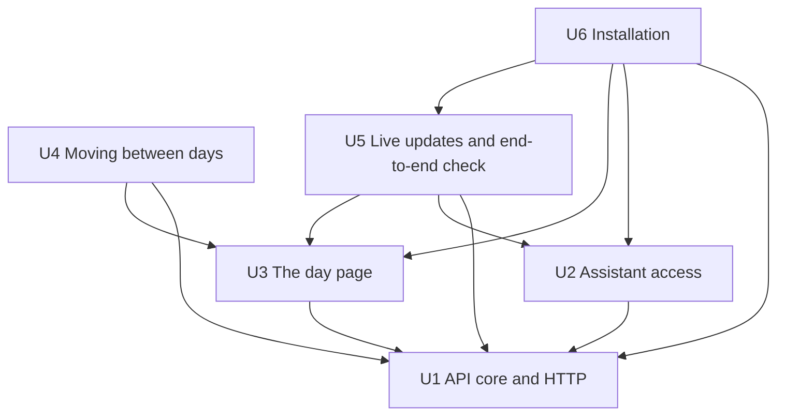

# Unit Dependencies — Dayboard, first version

What depends on what between the six Units in `unit-of-work.md`. This is topology only: it does not choose a build order or a critical path; Delivery Planning does that from this graph.

## Dependency Graph

```yaml
units:
  - name: u1-api-core
    kind: service
    depends_on: []
  - name: u2-assistant-access
    kind: service
    depends_on: [u1-api-core]
  - name: u3-day-page
    kind: ui
    depends_on: [u1-api-core]
  - name: u4-day-navigation
    kind: ui
    depends_on: [u1-api-core, u3-day-page]
  - name: u5-live-updates
    depends_on: [u1-api-core, u2-assistant-access, u3-day-page]
  - name: u6-installation
    kind: packaging
    depends_on: [u1-api-core, u2-assistant-access, u3-day-page, u5-live-updates]
```



<!-- Text fallback: An arrow points from a Unit to a Unit it depends on. U2 and U3 depend on U1. U4 depends on U1 and U3. U5 depends on U1, U2 and U3. U6 depends on U1, U2, U3 and U5. U1 depends on nothing. -->

## Mounting at Start-Up

Some component edges in `components.md` point from an earlier Unit to a later one: RequestGuard (U1) hands requests to McpInterface (U2); HttpInterface (U1) subscribes streams to LiveUpdates (U5); AppShell (U3) shows DayNavigation (U4) and starts LiveSync (U5); DayView (U3) learns changed items from LiveSync (U5). Followed literally, they would make the Unit graph cyclic.

They are safe because each of those connections is made at start-up, through a registration point the earlier Unit owns:

- **U1** exposes two registration points in the backend process: one where an MCP interface registers behind RequestGuard, and one where a day-changed stream registers on the HTTP interface. Without registrations, the backend serves the HTTP interface alone.
- **U3** exposes two places in the web app: a slot in the header for day navigation, and a hook where a live channel attaches to the app shell and reports changed items to the day view. Without them, the page shows the open day with no arrows or calendar and updates on reload.

So U1 and U3 are complete, buildable and testable on their own. U2, U4 and U5 register into these points when they are built, and nothing in U1 or U3 is left as a stub for them.

## Why Each Edge Exists

| Unit | Depends on | Why |
|---|---|---|
| U2 | U1 | The MCP tools call DayPages and CarryOver, and register into U1's MCP registration point behind RequestGuard |
| U3 | U1 | The web app reads and changes days through U1's HTTP interface |
| U4 | U1, U3 | Lists days through U1; sits in U3's header and uses its API client |
| U5 | U1, U2, U3 | Live updates read U1's change log and add a stream to its HTTP interface; Live sync extends U3's page and reads its own-change hash record; the end-to-end check drives the MCP server (U2) and the web server (U3) |
| U6 | U1, U2, U3, U5 | Installs and starts the backend (U1) with its MCP server (U2) and the web app (U3), shows how to connect an assistant, and documents running the end-to-end check (U5) after an update |

## Integration Points

| Between | How | Contract written by |
|---|---|---|
| U3, U4 → U1 | HTTP calls from the web app's API client, through RequestGuard | Contract Design, kept in U1 (Q3) |
| Assistant → U2 → U1 | MCP tools, in-process calls to DayPages and CarryOver | Contract Design, kept in U2 (Q3) |
| U5 web → U5 backend | Server-sent events stream of day-changed notices, through RequestGuard | Contract Design, kept in U5 (Q3) |
| U5 → U1 | Reads the highest change sequence and the changes after it through Storage | Storage interface in U1 |
| U5 → U3 | Reads the API client's own-change hash record; reports changed items to Day view | Inside the web app |
| U6 → U1, U2, U3, U5 | Uses each part's start command and settings, and the end-to-end check command | The start commands defined in U1, U2 and U3; the check defined in U5 |
| U2 → U1, U5 → U1, U4 → U3, U5 → U3 | Registration at start-up (see Mounting at Start-Up) | U1's MCP and stream registration points; U3's header slot and live-channel hook |

No Unit shares data with another except through these interfaces; only U1's Storage touches the data file (NFR10).

## Parallel Development

Units with no path between them can be built at the same time (Q5):

- **U2 and U3**: both need only U1.
- **U2 and U4**: U4 needs U1 and U3, U2 needs only U1.
- **U4 and U5**: neither depends on the other.
- **U4 and U6**: neither depends on the other.

Every valid order starts with U1, which has no dependencies and holds the privacy guard, so the guard is in place before any other Unit is built (team practices, Walking Skeleton). No walking skeleton applies: the team builds each Unit fully.

## Sources

- `unit-of-work.md`: the six Units and their components.
- `inception/domain-design/components.md`: the components' own `depends_on` edges. The Unit edges follow them except where a later Unit registers into an earlier one at start-up (see Mounting at Start-Up).
- `units-generation-questions.md`: Q2 ("First must be api core and http layer, then web units and mcp in parallel"), Q3, Q5, Q6, Q7 and your request for an installation Unit.

## Assumptions & Open Questions

None.
