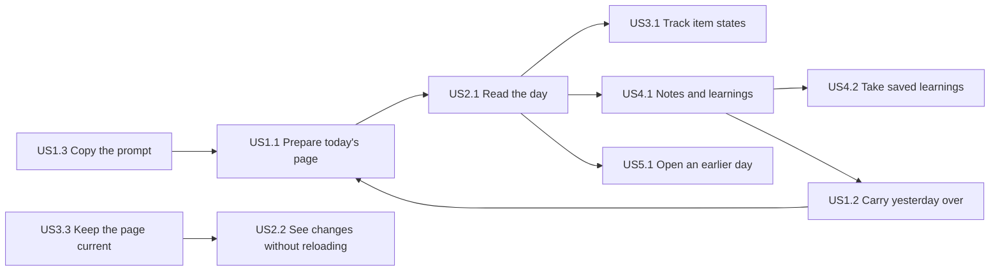

# User Stories — Dayboard, first version

Stories for the two personas in `personas.md`: **P1, the person** and **P2, the assistant**. They are grouped by the daily loop (Q2), one large story per epic (Q3), and every story traces to `inception/requirements-analysis/requirements.md` (see `traceability.json`). The privacy guard and the two-command run stay requirements (FR8), carried by the non-functional design stages (Q4). Ticking Markdown checkboxes is the one Could Have; every other story is a Must Have (Q5). All example content is made up.

Acceptance criteria use Given/When/Then. "The page" means the Dayboard web page; "a day" means one calendar date's page.

## Story Map

| Epic | Stories | Persona | Priority |
|---|---|---|---|
| 1. Preparing the day | US1.1 Prepare today's page; US1.2 Carry yesterday over; US1.3 Copy the prompt | P2, P2, P1 | Must, Must, Must |
| 2. Reading the day | US2.1 Read the day; US2.2 See changes without reloading | P1, P1 | Must, Must |
| 3. Acting on the day | US3.1 Track item states on the page; US3.2 Tick checkboxes in text; US3.3 Keep the page current as the assistant | P1, P1, P2 | Must, Could, Must |
| 4. Carrying over to tomorrow | US4.1 Leave notes and curate learnings; US4.2 Take saved learnings | P1, P2 | Must, Must |
| 5. Looking back | US5.1 Open an earlier day | P1 | Must |

The flowchart below shows the daily loop the stories serve, not a build order or dependencies: every story is built and tested on its own, and Units Generation sets the order.

<!-- Text fallback: The person copies the prompt (US1.3); the assistant carries yesterday over (US1.2) and prepares today's page (US1.1). The person reads the day (US2.1), tracks item states (US3.1), and leaves notes and curates learnings (US4.1), which the assistant takes (US4.2) and carries into the next day (US1.2). The assistant keeps the page current (US3.3), and the person sees its changes without reloading (US2.2). The person can open an earlier day (US5.1). -->

## Epic 1. Preparing the day

### US1.1 Prepare today's page

**As** the assistant, **I want** to see which days exist and what today is, and to create and fill today's page (or a day the person missed), **so that** the person has a page to read without asking me to rewrite a report in chat.

**Priority:** Must Have. **Requirements:** FR1.1–FR1.6, FR1.9, FR1.10, FR1.12, FR1.13, FR2.1–FR2.6, FR2.10, FR2.12; NFR3, NFR4.

| ID | Acceptance criterion |
|---|---|
| AC1.1.1 | **Given** days exist for 14 and 15 October and today is 16 October, **when** the assistant lists days, **then** it gets 2026-10-14 and 2026-10-15, oldest first, and today's date 2026-10-16. |
| AC1.1.2 | **Given** no page exists for today, **when** the assistant creates today's page with a title, a schedule block, two open-items blocks with their own titles and a notes block, **then** the page is stored with those blocks in that order, and every block and item gets its own identifier. |
| AC1.1.3 | **Given** no page exists for 12 October, a past date, **when** the assistant creates it, **then** the page is stored and appears in the list of days. |
| AC1.1.4 | **Given** today's page already exists, **when** the assistant tries to create it again, **then** the request is refused with an error saying the page exists, and nothing changes. |
| AC1.1.5 | **Given** today is 16 October, **when** the assistant tries to create a page for 17 October, **then** the request is refused with an error saying the date is in the future. |
| AC1.1.6 | **Given** a page with a notes block, **when** the assistant tries to add a second notes block, or a block of a kind that isn't one of the six, **then** the request is refused naming the problem, and nothing is stored. |
| AC1.1.7 | **Given** an item text one character over the 10,000-character limit, **when** the assistant writes it, **then** the request is refused naming the field and the limit; at exactly 10,000 characters it is stored. |
| AC1.1.8 | **Given** item text with emoji, right-to-left script, backticks, pipes and line breaks, **when** the assistant writes it and reads it back, **then** the text is byte-for-byte the same. |
| AC1.1.9 | **Given** this computer's local clock reads 23:59 on 16 October, **when** the assistant lists days, **then** today is 2026-10-16; **given** it reads 00:00 on 17 October, **then** today is 2026-10-17. |
| AC1.1.10 | **Given** a new item written into an open-items, pull-requests or waiting-on-others block without a state, **when** it is stored, **then** its state is open; **given** a new schedule item without an answer, **then** its answer is none. |
| AC1.1.11 | **Given** each remaining limit (page title 200 characters, block title 120, 10 links per item, a web address of 2,048 characters, 50 blocks per page, 200 items per block), **when** the assistant writes exactly the limit, **then** it is stored; **when** it writes one past the limit, **then** the request is refused naming the field and the limit, and nothing is stored. |
| AC1.1.12 | **Given** a day of 200 items and both apps running on this computer, **when** the assistant reads that day 20 times, **then** 95% of the reads return within 300 ms. |
| AC1.1.13 | **Given** the assistant reads 14 October and no page exists for it, **when** the read returns, **then** the answer says there is no page for that date, not an error about the request. |
| AC1.1.14 | **Given** today's page, **when** the assistant writes a timed meeting from 10:30 to 11:15 with the answer yes, an all-day meeting, and a timed meeting from 22:00 to 01:00, **then** all three are stored and read back with their all-day flag, times and answer, and the last one ends at 01:00 the next day; a meeting with equal start and end, a time like `25:61`, or a change that makes an all-day meeting timed without giving both times is refused naming the field; making a timed meeting all-day clears its times. |
| AC1.1.15 | **Given** the assistant connects to the MCP server, **when** it reads the server's description of its tools, **then** the description tells it to keep headings inside item text at level 3 ("###") or smaller. |
| AC1.1.16 | **Given** a night when the clocks jump from 02:00 to 03:00, **when** the assistant writes a meeting from 02:30 to 04:00 on that day, **then** it is stored as written and 02:30 counts as 03:00, its first valid instant; **given** a night when 02:00 to 03:00 repeats, a meeting ending at 02:30 counts as ending at the first 02:30. Both rules decide when the meeting turns Past. |

**INVEST notes:** independent of the page (testable through the MCP server alone); large by choice (Q3), split by Units Generation if needed.

### US1.2 Carry yesterday over

**As** the assistant, **I want** to read the notes for tomorrow and the delayed items of earlier days, **so that** today's page starts from what the person left open and nothing slips.

**Priority:** Must Have. **Requirements:** FR1.11, FR2.3, FR2.8, FR2.9.

| ID | Acceptance criterion |
|---|---|
| AC1.2.1 | **Given** today is Monday 19 October and the latest earlier day on record is Friday 16 October with two kept notes, **when** the assistant asks for notes without naming dates, **then** it gets Friday's two notes and the answer says they come from 2026-10-16. |
| AC1.2.2 | **Given** the assistant has already started Monday's page with one note, **when** it asks for notes without naming dates, **then** it gets Friday's notes plus Monday's note, and the answer names both dates. |
| AC1.2.3 | **Given** the assistant names 14 and 15 October and only 15 October has a page, **when** it asks for notes, **then** it gets 15 October's kept notes and a "no page" answer for 14 October. |
| AC1.2.4 | **Given** a note on Friday was discarded, **when** the assistant reads notes, **then** that note is not returned. |
| AC1.2.5 | **Given** no earlier day on record, **when** the assistant asks for notes without dates, **then** the answer says there are none. |
| AC1.2.6 | **Given** Friday has an item delayed to tomorrow, **when** Monday arrives and nobody acts on it, **then** it stays on Friday's page with the delayed state; it appears on Monday only if the assistant writes it there. |

### US1.3 Copy the prompt

**As** the person, **I want** to copy a ready-made instruction for my assistant from the page, **so that** I start each day's update with one paste instead of retyping what I want.

**Priority:** Must Have. **Requirements:** FR6.1–FR6.4, FR3.2, FR9.1.

| ID | Acceptance criterion |
|---|---|
| AC1.3.1 | **Given** the page is open on any day, **when** the person presses Copy prompt, **then** the clipboard holds the instruction to prepare or update today's page, and the button reads "Copied" for 2 seconds. |
| AC1.3.2 | **Given** an earlier day is open, **when** the person copies the prompt, **then** the instruction still targets today. |
| AC1.3.3 | **Given** no day is on record, **when** the person opens Dayboard, **then** the first-run view shows "No days yet" with a Copy prompt button. |
| AC1.3.4 | **Given** the browser refuses the copy, **when** the person presses Copy prompt, **then** the page shows "Couldn't copy. Select the prompt below." with the prompt as selectable text. |
| AC1.3.5 | **Given** the copied instruction, **when** it is read, **then** it asks the assistant to read the notes for tomorrow and the delayed items before writing, and it contains no personal, company or tool-specific names. |

## Epic 2. Reading the day

### US2.1 Read the day

**As** the person, **I want** Dayboard to open on my latest day and show it clearly, **so that** I can read what matters at a glance during the day.

**Priority:** Must Have. **Requirements:** FR1.13, FR3.1–FR3.10, FR4.10, FR7.1–FR7.6, FR9.1–FR9.3; NFR2, NFR7, NFR8.

| ID | Acceptance criterion |
|---|---|
| AC2.1.1 | **Given** days exist up to today, **when** the person opens the home address, **then** today's page opens at its own address, with the date as the main heading, the title, and the blocks in the order the assistant wrote them, each headed by its kind and title. |
| AC2.1.2 | **Given** the latest day on record is yesterday, **when** the person opens the home address, **then** yesterday's page opens. |
| AC2.1.3 | **Given** an address for a date with no page, or one that isn't a date, **when** it is opened, **then** the page shows "No page for this day" with Go to latest day. |
| AC2.1.4 | **Given** item text with headings, a table, a link and a picture, **when** the day is shown, **then** it is rendered as Markdown, the link opens in a new tab, and the picture loads with its description as alternative text. |
| AC2.1.5 | **Given** item text containing raw HTML or a `javascript:` link, **when** the day is shown, **then** no script runs and the link shows as plain text. |
| AC2.1.6 | **Given** a block with three done items and two open ones, **when** the day is shown, **then** the done items fold into "3 done", which opens in place to show them dimmed with their switches; a block with no items shows "Nothing here". |
| AC2.1.7 | **Given** the backend is not running, **when** the page loads, **then** it shows "Can't reach Dayboard on this computer. Is the backend running?" with Try again; when one day fails to load with the backend up, it shows "Couldn't load this day." with the header still usable. |
| AC2.1.8 | **Given** a 360 px wide window in dark mode, **when** the day is shown, **then** nothing scrolls sideways, each state switch sits under its item text, Copy prompt is an icon button, and every text comes from the English language file. |
| AC2.1.9 | **Given** a first visit, **when** the page opens, **then** the theme switch is on Auto and the page follows the system setting; **when** the person picks Dark and reloads, **then** the page stays dark. |
| AC2.1.10 | **Given** a day is loading, **when** the page is waiting for it, **then** the header stays in place and each block shows a grey placeholder row. |
| AC2.1.11 | **Given** one block the page can't show, **when** the day is shown, **then** that block reads "This block can't be shown" and the other blocks show normally. |
| AC2.1.12 | **Given** a text key missing from the English language file, **when** the element that uses it is shown, **then** it is empty or hidden and no substitute text appears. |
| AC2.1.13 | **Given** an item with one labelled link and one link without a label, **when** the day is shown, **then** the first shows its label and the second its address under the item text, and a link opened in a new tab gets no access to the Dayboard page. |
| AC2.1.14 | **Given** a day whose title is empty, **when** it is shown, **then** there is no title line under the date. |
| AC2.1.15 | **Given** a day of 200 items and both apps running on this computer, **when** the person opens it 20 times, **then** 95% of the loads show the content within 1 s of navigation. |
| AC2.1.16 | **Given** each of the screens S1 to S6, in light and dark, at 360 px and desktop width, **when** the automated accessibility scan runs, **then** it reports no WCAG 2.1 AA violations; every touch target is at least 44 px, and save failures, "Copied" and "Couldn't copy" are announced through a polite live region. |
| AC2.1.17 | **Given** today's schedule has a meeting from 10:30 to 11:15 and the page is open, **when** the clock passes 11:15, **then** within 5 seconds the meeting shows dimmed and marked "Past" without a reload, keeps its answer control, and its dimmed text keeps 4.5:1 contrast; **given** yesterday's meeting from 22:00 to 01:00, **then** at 00:30 today it is not Past and at 01:00 it is. |
| AC2.1.18 | **Given** a schedule block written as a 14:00 meeting, an all-day meeting and a 09:00 meeting, **when** the day is shown, **then** the all-day meeting shows first with "All day", then 09:00, then 14:00; an event from 22:00 to 01:00 shows its end as "→ 01:00". |
| AC2.1.19 | **Given** an all-day meeting today and one on an earlier day, **when** the day is shown, **then** the earlier day's meeting is Past, today's is not, and today's turns Past within 5 seconds of midnight while the page is open. |
| AC2.1.20 | **Given** two meetings both starting at 09:00, stored in the order B then A, **when** the day is shown, **then** B shows before A; **when** the assistant reorders the schedule block, **then** the display order stays all-day first, then by start time. |
| AC2.1.21 | **Given** a meeting ending at 15:00 shows as not Past at 14:30, **when** this computer's clock is set forward to 15:10 (or a daylight-saving change moves local time past 15:00), **then** the meeting shows as Past within 5 seconds, following the clock as it reads now. |

### US2.2 See changes without reloading

**As** the person, **I want** the open page to show my assistant's changes by itself, **so that** I never reload after each edit.

**Priority:** Must Have. **Requirements:** FR3.11, FR3.13–FR3.16; NFR2.

| ID | Acceptance criterion |
|---|---|
| AC2.2.1 | **Given** today's page is open, **when** the assistant adds an item to it, **then** the item appears on the page within 2 seconds without a reload. |
| AC2.2.2 | **Given** the person is typing a note, **when** an update to the same day arrives, **then** the typed text, the keyboard focus and any open calendar, confirmation or "N done" list stay as they were. |
| AC2.2.3 | **Given** the assistant creates a page for a missed day, **when** the person has the calendar open, **then** that date stops being greyed out and the arrows include it. |
| AC2.2.4 | **Given** the open day is removed by the assistant, **when** the update arrives, **then** the page shows "No page for this day" for that date. |
| AC2.2.5 | **Given** the backend restarts while the page is open, **when** it comes back, **then** the page reconnects on its own and shows every change made in between. |
| AC2.2.6 | **Given** the page is open on a wide window, **when** the assistant changes or adds an item, **then** that item gets a soft highlight that fades over 2 seconds and a toast "This day was updated" shows at the top right for 5 seconds, announced politely; at phone width the toast shows at the bottom; with reduced motion asked for, the highlight shows without animating. |
| AC2.2.7 | **Given** three changes from the assistant or another tab arrive within 5 seconds, **when** they reach the open page, **then** one toast shows and each changed or added item is highlighted; a removal also shows the toast, though the removed item has nothing left to highlight; a change the person makes in this tab shows neither. |
| AC2.2.8 | **Given** the person is typing a note in a block, **when** the assistant removes that block, **then** the block and the typed text disappear, with no message about the dropped text, while the usual "This day was updated" toast still shows for the removal; an open confirmation for a removed item closes the same way. |

## Epic 3. Acting on the day

### US3.1 Track item states on the page

**As** the person, **I want** to mark items open, done or later, and remove items or blocks I don't need, **so that** the page reflects where my day stands.

**Priority:** Must Have. **Requirements:** FR4.1, FR4.2, FR4.8, FR4.9, FR1.13, FR3.5.

| ID | Acceptance criterion |
|---|---|
| AC3.1.1 | **Given** an open item in an open-items block, **when** the person selects Done on its switch, **then** the switch shows Done at once, the change is stored, and the item folds into the "N done" line. |
| AC3.1.2 | **Given** an item in a waiting-on-others block, **when** its switch is shown, **then** its done segment reads "Closed"; in a pull-requests block it reads "Merged"; in an open-items block it reads "Done". |
| AC3.1.3 | **Given** saving fails, **when** the person changes a state, **then** the switch returns to the stored state and "Couldn't save, try again" is announced. |
| AC3.1.4 | **Given** the assistant reordered the block since the page last read it, **when** the person changes a state from the earlier read, **then** the change is refused, the switch returns to the stored state with "This changed, try again", the current page is shown, and the assistant's order is kept. |
| AC3.1.5 | **Given** a block the person no longer needs, **when** they choose to remove it, **then** a confirmation names the block; confirming removes it, cancelling keeps it. The page offers no way to remove a whole day. |
| AC3.1.6 | **Given** keyboard use only, **when** the person reaches a state switch, **then** it is a radio group moved with the arrow keys. |
| AC3.1.7 | **Given** both apps running on this computer, **when** the person changes item states 50 times, **then** 95% of the changes are stored within 300 ms. |
| AC3.1.8 | **Given** a meeting with no answer yet, **when** the person picks Maybe on its answer control, **then** Maybe shows at once and is stored; the meeting has no Open / Done / Later switch, and a failed save returns the control to the stored answer with "Couldn't save, try again". |

### US3.2 Tick checkboxes in text

**As** the person, **I want** to tick a checklist written inside an item's text, **so that** small sub-steps can be checked off where they're written.

**Priority:** Could Have. **Requirements:** FR3.12.

| ID | Acceptance criterion |
|---|---|
| AC3.2.1 | **Given** an item whose text holds the task list "- [ ] draft" and "- [ ] send", **when** the person ticks "draft", **then** the stored text changes to "- [x] draft" and nothing else in it changes; **when** the person then unticks it, **then** it changes back to "- [ ] draft", again touching nothing else. |
| AC3.2.2 | **Given** saving fails, **when** the person ticks a checkbox, **then** it returns to its stored state with "Couldn't save, try again". |
| AC3.2.3 | **Given** the assistant has removed that checkbox line, **when** the person ticks it from an earlier read, **then** the tick is refused with "This changed, try again" and the current text is shown. |

### US3.3 Keep the page current as the assistant

**As** the assistant, **I want** to update, reorder and remove what is on any day, **so that** the page follows the person's day as they ask me to change it.

**Priority:** Must Have. **Requirements:** FR1.7, FR1.12, FR2.5–FR2.7, FR2.10, FR4.9.

| ID | Acceptance criterion |
|---|---|
| AC3.3.1 | **Given** the assistant read today's page and nothing changed since, **when** it moves an item from Open to Later, quoting the page hash it read, **then** the change is stored and the page hash changes. |
| AC3.3.2 | **Given** the person changed an item after the assistant's last read, **when** the assistant sends a change with the old hash, **then** it is refused with an error saying the page changed since it was read, nothing is stored, and a fresh read lets the retry succeed. |
| AC3.3.3 | **Given** a block with items A, B, C, **when** the assistant reorders them to C, A, B, **then** each item keeps its identifier and a later change addressed to B lands on B. |
| AC3.3.4 | **Given** an item, a block and a whole day, **when** the assistant removes each, **then** each is gone; the removed day disappears from the list of days and the calendar. |
| AC3.3.5 | **Given** a saved learning, **when** the assistant tries to set it back to unsaved, **then** the request is refused naming the item and the change, and nothing is stored. |
| AC3.3.6 | **Given** an existing page, **when** the assistant changes its title, retitles a block and replaces an item's link, quoting the current page hash, **then** all three are stored and the open page shows them. |
| AC3.3.7 | **Given** a discarded learning or note, **when** the assistant tries to change its state, **then** the request is refused naming the item and the change, and nothing is stored. |
| AC3.3.8 | **Given** a meeting with no answer, **when** the assistant sets its answer to Maybe quoting the current page hash, **then** Maybe is stored and the open page shows it; **when** it then clears the answer, **then** the meeting reads back with no answer; the same change sent with an outdated hash is refused as in AC3.3.2. |
| AC3.3.9 | **Given** a kept note on today's page, **when** the assistant discards it quoting the current page hash, **then** the note no longer appears in reads of the day or in notes for tomorrow, and the open page removes it. |

## Epic 4. Carrying over to tomorrow

### US4.1 Leave notes and curate learnings

**As** the person, **I want** to write notes for tomorrow and keep or discard learnings on the page, **so that** tomorrow starts from what I decided today.

**Priority:** Must Have. **Requirements:** FR1.7, FR1.8, FR4.3–FR4.7, FR3.10.

| ID | Acceptance criterion |
|---|---|
| AC4.1.1 | **Given** a day without a notes block, **when** the person types into "Add a note for tomorrow" and presses Enter, **then** a notes block is created at the end of the day with that note, and the standing field is replaced by the block's own field. |
| AC4.1.2 | **Given** an empty or whitespace-only entry, **when** the person presses Add, **then** nothing is added; when saving fails, the typed text stays in the field with "Couldn't save, try again". |
| AC4.1.3 | **Given** an unsaved learning, **when** the person presses Save, **then** it is marked "Saved" and only Discard remains. |
| AC4.1.4 | **Given** a note or a learning, **when** the person presses Discard and confirms, **then** it disappears for the person and the assistant; cancelling keeps it. There is no undo. |
| AC4.1.5 | **Given** an earlier day that has a page, **when** the person adds a note or a learning there, **then** it is stored on that day, the same as on today. |
| AC4.1.6 | **Given** the person adds a learning on the page, **when** it is stored, **then** it is unsaved and offers Save and Discard, like one the assistant wrote. |
| AC4.1.7 | **Given** the page changed since the web page last read it, **when** the person adds a note, saves or discards a learning or note, or removes an item or block, **then** the change is refused with "This changed, try again", nothing is stored, the current page is shown, and any typed text stays in its field. This holds for every change made from the page. |
| AC4.1.8 | **Given** text with emoji, right-to-left script, backticks, pipes and line breaks, **when** the person adds it as a note and as a learning from the page, and ticks a checkbox in an item holding such text, **then** reading the day back returns every text byte-for-byte as written, apart from the ticked marker. |

### US4.2 Take saved learnings

**As** the assistant, **I want** to read saved learnings across days and mark the ones I've taken, **so that** the person's kept learnings reach my own memory and the page shows what is still waiting.

**Priority:** Must Have. **Requirements:** FR2.6, FR2.11, FR1.7.

| ID | Acceptance criterion |
|---|---|
| AC4.2.1 | **Given** learnings across 14 to 16 October that are unsaved, saved and discarded, **when** the assistant reads learnings for that range, **then** it gets only the saved, not-discarded ones, with their dates. |
| AC4.2.2 | **Given** the assistant reads one day's page, **when** that day has unsaved learnings, **then** they are returned marked unsaved, and discarded ones are not returned. |
| AC4.2.3 | **Given** the person told the assistant to keep a learning, **when** the assistant marks it saved, **then** the page shows it as "Saved" with only Discard. |
| AC4.2.4 | **Given** a learning the person rejected, **when** the assistant discards it, **then** it disappears from the page and from later reads. |

## Epic 5. Looking back

### US5.1 Open an earlier day

**As** the person, **I want** to step back through days or pick one from a calendar, **so that** I can look up what happened earlier.

**Priority:** Must Have. **Requirements:** FR5.1–FR5.4, FR3.3.

| ID | Acceptance criterion |
|---|---|
| AC5.1.1 | **Given** days exist on 14 and 16 October but not 15, **when** the person presses the previous arrow on 16 October, **then** 14 October opens at its own address. |
| AC5.1.2 | **Given** the first day on record is open, **when** the arrows are shown, **then** the previous arrow is disabled and named "No earlier day"; on the latest day the next arrow is disabled and named "No later day". |
| AC5.1.3 | **Given** the person presses the date, **when** the calendar opens, **then** every date shows its number, dates without a page are greyed out and can't be chosen, and Go to latest day opens the latest day. |
| AC5.1.4 | **Given** the calendar is open, **when** the person uses the keyboard, **then** the arrow keys move only between days with a page, Enter opens one, and Escape closes the calendar and returns focus to the date. |
| AC5.1.5 | **Given** a 360 px wide window, **when** the calendar opens, **then** it is a full-width panel under the header with a close button. |
| AC5.1.6 | **Given** the calendar shows October 2026, **when** the person presses the next-month arrow and then the previous-month arrow, **then** November 2026 shows with every date numbered and dates without a page greyed out, and then October shows again. |

## Not Written as Stories

- **Running it and the privacy guard** (FR8.1–FR8.7): kept as requirements (Q4) and carried by NFR Requirements and NFR Design; their tests run from the first Unit (`team-practices.md`, Testing Posture). Units Generation lists FR8 and NFR1 as the first Unit's own acceptance, as the project rule puts the privacy guard in the first slice.
- **Measures** (NFR1–NFR12): kept as requirements; the stories above reference the ones that shape their criteria.

## Sources

- `inception/requirements-analysis/requirements.md`: every FR and NFR referenced above.
- `inception/practices-discovery/team-practices.md`: Testing Posture (test types), Way of Working (two developers claiming Units).
- `personas.md`: P1 and P2.
- `user-stories-questions.md`: Q1 to Q5 and the confirmed summary.
- `ideation/rough-mockups/wireframes.md`: screen wording reused in the criteria.

## Assumptions & Open Questions

- [assumption] Stories are large by choice (Q3); Units Generation may split one story across Units, keeping its IDs. US2.1 in particular may split by concern: rendering and safety (AC2.1.4, AC2.1.5, AC2.1.13), states and errors (AC2.1.3, AC2.1.6, AC2.1.7, AC2.1.10, AC2.1.11), and layout, theme and text (AC2.1.8, AC2.1.9, AC2.1.12, AC2.1.14, AC2.1.16).
- Labels on items were dropped for this version (requirement FR1.14 withdrawn), so no story covers them.
